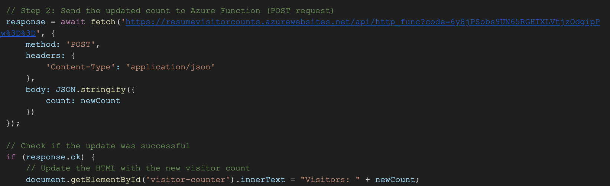
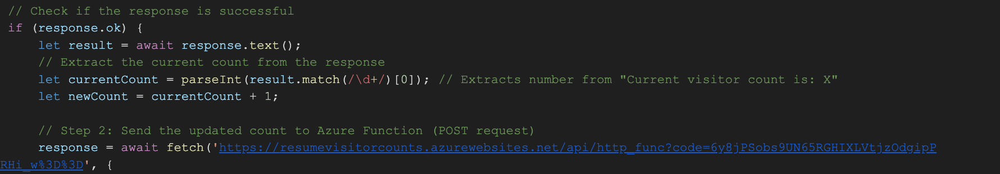
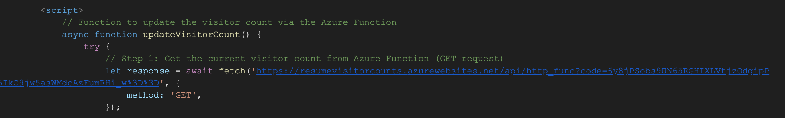
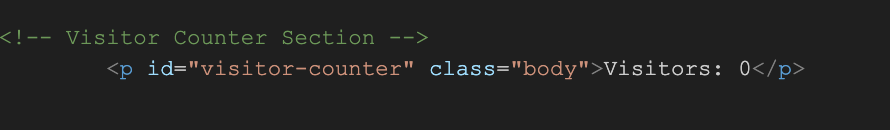

# Azure Cloud Resume Challenge

**Alright I'm starting this challenge over from scratch because I don't remember it. Lets take it on a day-by-day basis.**

Phase 1: Frontend & Azure Hosting

Phase 2: Visitor Counter Backend

Phase 3: Frontend & Backend Integration

Phase 4: Terraform Everything

Phase 5: CI/CD & Security

Phase 6: Testing, Monitoring, & Production Validation

Phase 7: Portfolio & Interview Demo

## 11.14.2026

Okay I asked AI to help me figure out the structure of my JavaScript (JS) code before I started searching the internet. I told it my mental workflow and it said that was correct. It then told me the 3 things I would need to code my workflow so I googled that. After some feedback, they said my `JSON.parse` piece was wrong because my API doesn't return back raw text. It returns an HTTP Response (headers, status codes, and body). It fixed that and reworked my DOMContentLoaded block. The workflow for this is the DOMContentLoaded block says wait until my index.html file is completed loaded and THEN run the function below. We defined the function below with the block below that called the async function block. We can do this out of order because of a concept called hoisting. 

The function block really just says lets define a variable named response. The information in response will be filled using the values we get from fetching the HTTP response from our URL. That's an HTTP response, not JSON but we want the JSON values out of it. So our next line, const countJson, will take our response variable and turn it into JSON. Then our last line const count says retrieve the count value from our countJson array. 

Thats it! Easy peasy. 

I had to add my Azure Front Door endpoint to my CORS as well. I also had to update my index.html file and my css file for the Page Views. I'm going to stop here for now because I'm definitely getting tired. 


## 11.13.2026

Lets create the database resource for our backend. We'll do Azure Cosmos DB for NoSQL. Pretty much keep everything default here. After the DB is created, go to Data Explorer and create a database. Then create a container. Now click on the container that you created and click Items. Then New Item. Paste this syntax into the field:

```
{
  "id": "visitorCount",
  "count": 0
```

Now lets create our Azure Function. When creating the Function, use the Python Runtime stack. Everything else is default. 

Okay once that's deployed, lets just fix the CORS part now. CORS - cross-origin resource sharing. I added my `https://www.evcloudresumechallenge.com` and the one without `www` to this list and Saved it. You can get here by going to your Function App and navigating to API > CORS. 

Okay lets move to the CRC-Backend directory on my local machine. We'll run the coommands
```
func init . --python
func new
```

Lets go into our Database and grab the connection string. This will allow our Function to talk to our DB. Go to your DB and navigate to Keys. You should see your Primary Connection String. Copy that and open your local.settings.json. Add it in your values section using the syntax:

```
"CosmosDbConnectionString": "AccountEndpoint=https://azure.com;"
```
Now, add the azure-cosmos package to your requirements.txt file (you can see mine in my repo). Afterwards, install the packages using `pip install --no-cache-dir -r requirements.txt`. 

Copilot is down so I'm going to use Google AI + whatever resources I can find online. So back to the Python virtual environment. You can literally google this. We did this a few times in labs so I'm not going to write the directions here. Use the above `pip install` command to install the packages and use `pip list` to verify that they're in the list. 

Okay s/o to Google AI. It definitely walked me through the process of creating this code and helping me work through the code I found online. I have to go back over the classes, instances, all that Python stuff. I don't remember it and how they store values. And how you insert values into where they store it. I just kind of remember how to call upon them (a lot of layer1.layer2.layer3 with the dots and stuff). Anyway, we only made 6 lines of code honestly. We needed to connect to our Azure Cosmos DB resource, ask it for the database, then ask it for the container inside of that database. After that, we asked for the item and partition key. We updated the item value (count), and then update the count in the database. 

We removed the try/except parts of the code (I couldn't even really read it honestly) and updated the HttpResponse with just the VisitorCount and what the current value is. We also put in an HTTP 200 OK response. To run this in your local machine, run func start and once you get the green local URL, press Ctrl + Click and you should see your validation information there. You can also check the portal to see if your counter increased. 

So apparently we need to push our function code up to our app. We'll use `func azure functionapp publish <your_function_app_name>`. Also, maybe before doing this, add your `CosmosDbConnectionString` environment variable to your Azure Function. Grab the primary key string from your Cosmos DB and then head to your Azure Function resource. Navigate to Settings > Environment variables and here, add a new entry under App settings. Hit Apply afterwards. My function app name is `ev-crc-function` btw. 

Once you run the publish command, you'll get a public URL and when you visit this URL, your count will increment! Now we're cooking!


## 11.12.2026

After you've uploaded all of your files in the right directories, you can go to your `$web` public endpoint (go to the container and click on Properties) and you should be able to access your webpage. It's beautiful, isn't it?

Lets recreate this resource in Terraform before we get too far. You'll be able to find my code in my CRC-Terraform repo. We're going to use terraform import to allow Terraform to manage this resource we already created. First get the id for your storage account using the `az storage account name` command. I'll list out the exact command in my notes file in my repo so search there. Copy that ID and then use the terraform import command listed in my notes as well. I ran into an issue saying the storage account resource does not exist in the configuration. 

So what does Terraform import do? So we added our resource to our main.tf file but Terraform import basically tells Terraform "hey, start to track this. This was created in the portal and I added it to our configs so you need to be aware of it." Terraform does this by using the resource ID provided by Azure. It's unique to that resource (think like an UUID). Then once it's imported, Terraform is aware of it. You can use `terraform state list` to show the resources currently recorded in the Terraform state. 

Do the same command for the static website except change the azurerm part to reflect the new resource. The ID will be the same though. 

Alright lets complete the Azure Front Door part. We'll use the Quick Create option here. A few options: Choose Storage (Static website), your storage account, Enable caching, Choose Ignore Query String, and Enable Compression. Review + create. 

Now, go to your Front Door resource and go to Front Door manager. Make sure under your manager and your origin groups that both of the default-origins use HTTPS for the protocols. If they don't, your website will not load. I ran into this issue for 20 minutes because Front Door may have needed to propagate the changes but turns out the settings were wrong. 

Alright, lets get the custom domain name going. I chose `evcloudresumechallenge.com` again and had to pay $12 for it. Go back to Front Door and navigate to Settings > Domains > Add a domain. Choose Non-Azure validated domain and All other DNS services. Then enter your www.<url_name>.com. Leave everything else as default and then hit Add. 

Click on the new domain name entry you created. Click the Pending status more specifically. You should be given an TXT record with the record name and value. Put the record name in the Name field and record value in the Content field. As least in Cloudflare that's how you'll do it. Okay, navigate back to your domain in AFD and on the right hand side, click the three dots. You'll see the `Associate` option. Choose that and then Select endpoint. Use your azurefd.net endpoint. Also choose your default-route for Select routes as well. Finally, go into Cloudflare and make a CNAME record. The Name will be `www` and then content will be your AFD url without any leading values. So the same URL you see on the AFD Overview page. 

You'll have to give this some time to propagate. While that was happening, I defined all of my Terraform blocks and started to import them. I ran into the silliest issue with the first CDN block. The g in resourcegroups in the reousrce ID wasn't capitalized so that caused the import to fail. I would've never noticed that. Same thing with the endpoint. The E in afdEndpoints had to be capitalized. I imported the 4 Front Door resources so we're good there. 


## 11.11.2026

Lets move on to Phase 1. Lets first create our directory tree in the frontend directory. We're creating an `index.html` file, a `css` directory, a `js` directory for JavaScript, and the README.md file which would could've just created from the repo. Now, I already created the HTML file years ago (back in 2022) so I'm going to give this to AI and have it update it. I also have the CSS file but I'm going to steal a better template off of the internet. These files will be publicly hosted in my GitHub so you all can feel free to take them.

To see the actual deployment, go to your index.html file, right click it and then press open in web browser (mine is Explorer). You should be able to see it there. 

Okay the website is beautiful! Nice! Okay lets create the Storage Account to hold our files. Go into the portal and search for Storage Account.

Lets keep a lot of these configuration basic: Choose Azure Blob Storage, workload is General Purpose, Performance is Standard, and Redundancy is LRS. We don't need anything fancy or costly. We just want to store the files. Some clarity on Azure Storage, the Storage Account is the top-level resource that provides ACCESS to different storage services. For blob storage, containers are organizational boundaries inside the account. 

Azure's static website feature creates a special container called: `$web` so this is where our files will live. Azure makes creating static webpages easier so this is their format. 

For the Advanced tab, leave everything off except the Hot storage. Keep that Hot. On networking, leave everything as default (Enable public network access and public network access scope). Don't add a private endpoint. Choose Microsoft network routing for the Network Routing. For insight, Azure Front Door will sit betwen the public internet and the Storage static website so that will be our security checkpoint in a way. 

For the Data protection, only enable soft delete for blobs and soft delete for containers. For Security, Enable Require secure transfer for REST API operations, storage account key access, and default to Microsoft Entra authorization in the Azure portal. 

Keep Encryption as the default options. Then Review & Create. 

Now go to the Storage Account. On the left hand side, navigate to Data management > Static website. Enable it! Then, enter in `index.html` for your index document name. Now Save it so Azure will create the `$web` container. You should now have a primary endpoint that's based on the generic Azure name. 

Okay, now I need to create basically the same file structure as my Frontend repo but here in `$web` but when I tried to do that, I ran into a permissions issue. Great, AWS IAM roles all over it. Go back to your storage account and click on Access Control (IAM). Press Add Role Assignment and search for Storage Blob Data Contributor. Select it and press next. Then Choose User for the Assign access to. Then Add yourself under the Members. Then just press Review and Assign. 

Once that's done and propagates, you should be able to add files now. Make sure this directory matches what you created on your local device. Just go back to your $web container and upload the three files: index, styles, and visitor files. 

## 11.10.2026

We're going to set up some cost guardrails first. In Azure, navigate to Cost Management + Billing. Click on your subscription (mine is Edward _____) and then under the Cost management blade, click Budgets. Here, you can create a budget alerting system. I made a monthly budget of $50 and created alerts for 50%, 80%, and 100% of my budget being consumed. The doesn't cap your budget. It just lets you know when the spending is reaching these limits. 

Alright now Im going go create separate repos for my frontend, backend, and Terraform. I'm going to also create local directories on my local machine for each one of these repos and clone each repo to it's respective directory. You can actually just stay in the overall parent directory (in my case, `Cloud-Resume-Challenge-2026`) and just do git clone three times. But you specifically have to do `git clone <repo-url> <local-directory-name>` so Git will automatically create the folder for you. In the parent directory, run `code .`


Okay I created about 5 TF files: version, provider, outputs, variables, and main. We're just going to initialize TF and then make sure we can create a resource group. That's it. Okay Terraform was throwing me an error. It said it was due to my providers.tf file and said I needed to log in. I ran the AZ command to log in, I was logged and then it said there were no subscriptions for my email address. AI had me run `az account clear` and then `az login --tenant <tenant-id>` so make sure I was logged into the right tenant. You can find your tenant ID but literally typing tenant in to the Azure search bar. Afterwards, I also had to run `az account get-access-token` just to make sure we're able to get a token if we need it. It's a validation test. 

We then ran the usual TF commands. We also did `az group list` and saw that our RG was deployed! You can also see it in the portal as well. 

## 02.01.2025

**Today's Topics**
* Steps 1 - X


Chunk 3: Front-end / back-end integration

Step 8 - Tests 

Okay so we're going to go over tests today and how to incorporate that into our code. I actually need to see if my edited code works first but we'll revisit that when I get back home to my personal laptop. Well, maybe. 

"Create a new project folder and, inside that, create a new folder called my_sum. Inside my_sum, create an empty file called __init__.py. Creating the __init__.py file means that the my_sum folder can be imported as a module from the parent directory."
^^^ I don't think I knew this. 

Assertions - writing a test to validate the output against a known response. 

Here are some things to think about when making tests:

-> What do you want to test?

-> Are you writing a unit test or an integration test?

-> Create you inputs. Execute the code being tested. Capture the output. Compare the output with an expected result.

-> Think of other behaviors your code would have or additional input that can mess up your code. Test against these things to make sure your code is robust.

You can use the `.assert` method to do tests. This method has additional methods on it to do common testing such as `.assertEqual(a,b)` and `.assertFalse(x)` so keep this in mind. 

Word. Let me review my code again. Went over load balancers instead. Just in case. (Should have done this remotely. ) (Done with this)


Step 7 - Javascript 


Now, lets update our `response` variable and compute an `await fetch` back to our HTTP Trigger but this time, we're going to use a POST method, create a JSON header, and in the body of our fetch, we're going to include the `newCount` variable which is our updated visitor counter. This will trigger the POST section of our Python code and our code will send the new visitor counter back to the Cosmos DB. 

If we receive an HTTP status code of 200 back from the Python code, we're going to call on our visitor counter ID from earlier and use the `.innertext` method to specify we want to change the text we see for that ID. It will be pretty much the same text string but we're going to add the `newCount` variable onto the end of it. 

Now, I've included some tests to make sure all of my code is working regardless of what value is placed in the code for the visitor counter. At the end, we have to call the function. Then everything should work. 





Now, our Python code should hopefully send back an HTTP status code of 200 which the `response` object will accept as ok hence the `response.ok`. The Python code is supposed to generate a text (visitor current count) and an HTTP status. If this looks good, we're going to define a new variable named `result` which we'll get from the actual text of the `response` variable. This text should be `Visitor counter: X`. This is how we'll get our current visitor counter. We'll create a `currentCount` variable by using a RegEx expression to extract the value from the `Visitor counter: X` text by using `parseInt` which just turns your string into an integer. Remeber, `result = response.text` so we'll use our `result` variable with the match method to find a digit using `/\d+/[0]`. Lets review this. The `//` part just says we're about to initialize a RegEx operation. The `\d+` just says we're looking for a multiple number digit (this is just in case our visitor counter is bigger than a single digit). Lastly, this match method returns an array (think of a list for Python). Yes, we only have one value in our array/list but we still have to call that index which is where `[0]` comes into play. That will call the index associated with our visitor counter number. So that explains the entire `parseInt(result.match(/\d+/)[0])`. Once we have that information, we're just going to make a new variable and add 1 to the current count. 




Now, just as we define paragraphs and the body of the HTML file, we also have to define the script section of the file using `<script>`. We're going to use an asynchronous function so we can make use of the `await` commands. This allows the function to wait while we retrieve and send data. We're going to use a large `try` statement for both our GET and POST statements. We define a variable name `response` that will store the the value of the current counter from our HTTP Trigger. We use `await` so that our script will wait for the response from our trigger and we use the fetch command with the GET method in order to trigger the GET portion of our Python code. Our Python code will retrieve the current count from the Cosmos DB and send it back to the Javascript code along with the HTTP status which will all be stored in the `response` variable. Think of the `response` variable as an object in Python just for Javascript. 




Here, we're creating our Visitor Counter indicator. We're assigning it an Id so we can alter the counter number later on in the script. Think of a ID sort of like a variable we can call on later. 




Chunk 2: Building the API

Step 13 - Source Control

I skipped the source control, CI/CD, and IaC parts of this challenge. I didn't want to break everything I've done so far. If you want my experience on these topics, I'll be completing another project that showcases this skillset. 

Step 10 - Python

Now, we have to write our Python code for reaching out to our Cosmos DB table. Before we do this, lets import a few more modules. We'll import modules for storing the Table API details such as the endpoint, key, account name and table name. Then, we'll store these credentials in a variable. We'll pass these variables to the Table Client module functions so when our HTTP Trigger is launched, Azure Functions will automatically connect to our Cosmos DB Table. 

Within our function, we're only going to have two simple parts of our code (which we'll expand on later with unit tests) but we're going to simply GET the value of website visit counter, pass it to our Javascript code in our HTML file (which will increment it by 1 and pass it back to the Python file) and then POST it back to the DB table. We're using the Table Client module functions to interact with the Table entity and count value. The `req` object has methods that will let us know if the request was a GET or a POST. When someone visits the website, it should be a GET request. When the Javascript increments the counter, the request should be a POST. When it's a GET, we'll just returnt the value of the current count. When it's a POST, we're going to us the `req.get_json()` object and method to retrieve the JSON information from our incoming POST request. This should have the new count incremented by our Javascript code. We'll pass this information to a new variable and get the count information using the `.get('count')` method associated with out new variable. we'll assign this to a new variable called `new_count` and then pass this to our Table Client to give back to our Cosmos DB Table. 

Now, obviously we'll go over the Javascript code later but this is essentially how we'll GET and POST our visitor counter information. 

Step 9 - API

Here's where things start to get very interesting. We're going to use Azure Functions with an HTTP Trigger to make this part of the code work. So lets break this down as much as possible. We can think of Azure Functions as a PaaS (I think) where this service provides all the underlying infrastructure for us to just run a piece of code (in our case, Python). There's an Azure Function App that acts as a container that stores all of your Azure Functions in one place. So when you deploy the Azure Function App, you then have to create an HTTP Trigger instance of it. I believe this app itself has a public endpoint and you can route traffic through this endpoint to call to your specific function in the accompanying source files. 

Lets talk about the source files. When you create an instance of the Azure function (at least for the HTTP trigger), it will generate a few files for you such as `__init__.py` (where you are given a template code and this is where I will write my code), `host.json`, `function.json`, and etc. These files are stored IN Azure. While you can use Visual Studio Code (VSC) to edit these files locally on your device, you'll have to deploy them back to Azure so Azure can run them. Lets keep that in mind. 

So you can use VSC to get this entire process started. Download the Azure SDK and Azure Functions extensions in VSC so you can work with these files locally in your code editor. Once you do that, deploy an Azure Functions App (I named my ResumeVisitorCounts) and select the newest version of Python you can. I set the auth level to function (lets review why I did this). After that, you should have generate template for your HTTP trigger function located in your `__init__.py` file. You can change the name of this by the way but you'll have to specify this in `function.json` file in the scriptFile key-value. I changed mine to `function_app.py`. 

Lets talk about the basic HTTP trigger template you're given. You're given a few modules that are imported such as logging. Logging is important because it sends these log messages to a storage container for you to use later if anything happens with your app. You're also given the `azure.functions` module which will help you manipulate the HTTP information in your code. When you visit a website, this request is usually a GET or a POST (usually a GET) and all of your information is stored in a JSON file. The azure.functions module helps you manipulate the data in this JSON file. You're given a function named main that will accept a the GET JSON information in an object called `req` using the the azure.functions.HttpRequest method (Azure automatically gives your module an alias called `func` so we will be using this naming instead. 

Azure Apps automatically calls this function when someone visits your endpoint so you don't have to call it yourself. The generic template will allow you to pass a name arguement to the Azure function endpoint URL and it will display a message depending on if you give it a name or not. This is a way for you to test your endpoint and the code to make sure that it's working. 

**************************** Talk about the additional files in the HTTP Trigger when you get a chance. 

Step 8 - Database

So, lets get started with the API part. We deployed a Cosmos DB with Tables in order to store our counter value. If you hed to Data Explorer, you can create a new Table (which I called `TablesDB`) and then create a partition under these tables (which I called `VisitorCounts`) and then in entities, you can create your value which would just be `count` for our project. That concludes the DB being created! Now, we'll have to keep a record of the names and account keys and connection strings for the DB to use our Python code with it. You can find this under the Settings blade nad then clicking on the Connection strings tab. It should display the Account Name, Endpoint URL, and keys, and connection strings. Think of the connection string as a shortcut that includes both the endpoint and the key. The endpoint gets you to the DB and the key gets you inside the DB. 

Chunk 1: Building the Frontend

Step 6 - Azure DNS

Okay now this part was annoying. As a network engineer, I should know more about DNS but I don't. So we wanted to make sure we have our custom domain and Azure CDN public endpoint coincided. So the first thing I had to do was go ahead and buy a domain name which I wen to Cloud Flare to accomplish. 

Next, we had to deploy Azure DNS and get our name servers. Azure gives you 4 name servers that all sound very similar but that's okay. In Azure DNS, we had to add our Azure storage account public URL to these records. We had to add the given one and the `www` CNAME record as well. 

I'm going to jump ahead a bit here but we went into Cloud Flare and added CNAME records for our custom domain name to be linked to our Azure Functions App. We also added the 4 Azure DNS name servers to our Cloud Flare setup using the NS record type and pointed them towards our custom domain. 

Now, the thing about DNS is it takes a while to propagate so this can take up to a day or two for your custom domain name to be accessible. So if you get it wrong, you can't really tell. It was very frustrating but eventually I got it to work. 

Step 5 - HTTPS

We need to make sure our website is using HTTPS for a secure connection. We'll use Azure CDN for this. I know this is Azure Content Delivery Network. I need to go back over exactly what this is used for although I know it makes your content easily assessible to users across the globe because it distributes the content at a location nearest to the user. I still have to review the HTTPS part. 

Now, we use Azure CDN for HTTPS on the static website because the Azure storage account where your static website is hosted doesn't natively support HTTPS with custom domains. We eventually want to use a custom domain so we can have a cool sounding website. So we have to deploy an Azure CDN and attach it to our static website public endpoint to it. This will give us a new endpoint name with a different domain but it gives us the ability to connect to this endpoint using HTTPS. 


Step 4 - Static Website

Now we have to deploy our code to a static webpage in Azure. I kind of already had this set up as well. You have to go to your storage account in the Overview blade, you have to go to Capabilities and then select Static website. Here, you can find the link to your Static website with your `index.html` file. I already uploaded the HTML and CSS files to my `$web` container in my blob storage so when you copy the primary endpoint and paste it in your URL, it should take you to your Static webpage. 

This part was pretty easy. You can just click on the public endpoint and your HTML file with the CSS styling will pop right up! 

Step 2 & 3 - HTML & CSS

I need to write some HTML code for this portion to work. I've already done this but I really need to update my resume so I'm going to take the time to do that now. 

I had to go back over a refresher for HTML to see which parts I wanted to edit. I had to update my work experience which was pretty much copy and paste but I also had to realign my bullet points. I edited the bullet point placement in my CSS file. I was also encountering some weird issue where my LinkedIn Profile and my GItHub repo link wouldn't be on separate lines so I went ahead and used `<br>` to break them apart. I had to use a ton of `&nbsp` to space out the text though. My HTML code is so ugly. 

But it works. 

Just a quick recap of HTML, you have the document type `<!DOCTYPE HTML>` that will tell your web broswer what type of file it's working with. THen you have the `<html>` indicator that all of your HTML code will sit in. Then you have two major sections after this. You have the `<head>` tpe which will just kind determined the main page information such as the language and things of that nature. After that, you have the meat and potatoes which is the `<body>`. This is where all of your smaller document types such as your header `<h1>`, paragraph `<p>`, links `<a>`, list `<li>, and other things. These are the main ones I used for my document. You can also assign class values to each of these document types so when you start to create your CSS file, those style configurations will apply to all of the document types that have that class specified in them. This just makes things easier to manage. 

To link your HTML file to your CSS file, use the syntax `link rel="stylesheet" href="<name_of_CSS_file>`. I believe these files need to be in the same directory so whatever CSS configurations you do, it will shape the HTML file. 

This section was a very new learning experience but it wasn't difficult. If anything, the most difficult portion was making sure the spacing was right which I'm still have a few issues with. I had to keep use the `&nsbp` or whatever the spacing was to make sure was formatted correctly. Very annothing. 


Step 1 - Azure Certification

The first step of this project is to get an Azure certification. I have two Azure certifications: AZ - 900 and AZ - 104 so I'm definitely done with this portion of the project. I will be periodically reviewing the AZ - 104 labs and going into the AZ - 305 labs as well as the AZ - 700 course but that will be later. 

Step completed!
